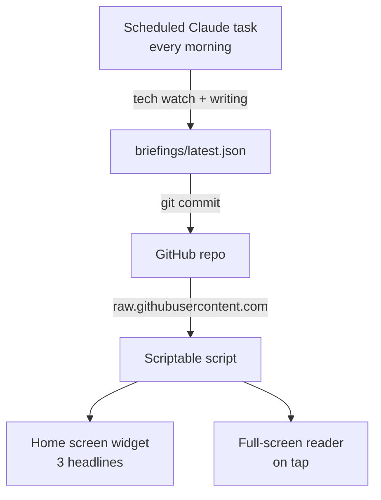

# 🪐 Orbit

A personal daily tech briefing, delivered as an iOS widget.

Every morning, an AI agent scans the news for the technologies I actually use, keeps only what matters, writes a ~10-minute briefing, and commits it to this repo. A [Scriptable](https://scriptable.app) widget on my iPhone reads it.

No server, no database, no hosting bill.

## How it works



1. **Generation**: a scheduled Claude task runs every morning, researches the latest releases, breaking changes, security advisories and notable articles, then writes `briefings/latest.json`.
2. **Storage & delivery**: the JSON is committed to this public repo. GitHub serves it over HTTPS, so the raw file *is* the API.
3. **Display**: `widget/orbit.js` fetches the JSON, renders the widget, and opens a full reader when tapped. The last briefing is cached on-device for offline use.

## Topics

Go · Rust · React · TanStack · Expo · Next.js · Astro · Supabase · Bun · Cloudflare · Claude

A topic only appears when there is real news. No filler.

## Briefing format

Validated against [`schema/briefing.schema.json`](schema/briefing.schema.json).

| Field | Description |
|---|---|
| `version` | Format version, so the widget can evolve without breaking |
| `date` | Briefing date |
| `readingTime` | Estimated reading time, in minutes |
| `headlines` | Up to 3 short lines, ready for the widget |
| `items[].topic` | One of the topic slugs above |
| `items[].kind` | `release`, `breaking`, `security` or `article` |
| `items[].summary` | What changed, in a few sentences |
| `items[].whyItMatters` | The concrete impact on my projects |
| `items[].url` | Primary source |

## Repository structure

```
orbit/
├── briefings/latest.json        # Today's briefing (updated daily)
├── schema/briefing.schema.json  # JSON Schema contract
├── widget/orbit.js              # Scriptable script
└── docs/                        # System design
```

## Install the widget

1. Install [Scriptable](https://apps.apple.com/app/scriptable/id1405459188) on iOS.
2. Create a new script named **Orbit** and paste the content of [`widget/orbit.js`](widget/orbit.js).
3. Add a Scriptable widget to your home screen (small, medium or large).
4. Long-press the widget → **Edit Widget** → **Script: Orbit**.

Tap the widget to open the full briefing. Links open in Safari.

## Design decisions

- **Static file over API**: one consumer, one update per day. A versioned JSON file on GitHub covers it with zero infrastructure.
- **Scriptable over a native app**: a widget plus an in-app WebView reader, without Xcode or App Store review.
- **`whyItMatters` over raw links**: the value is curation and context, not aggregation.
